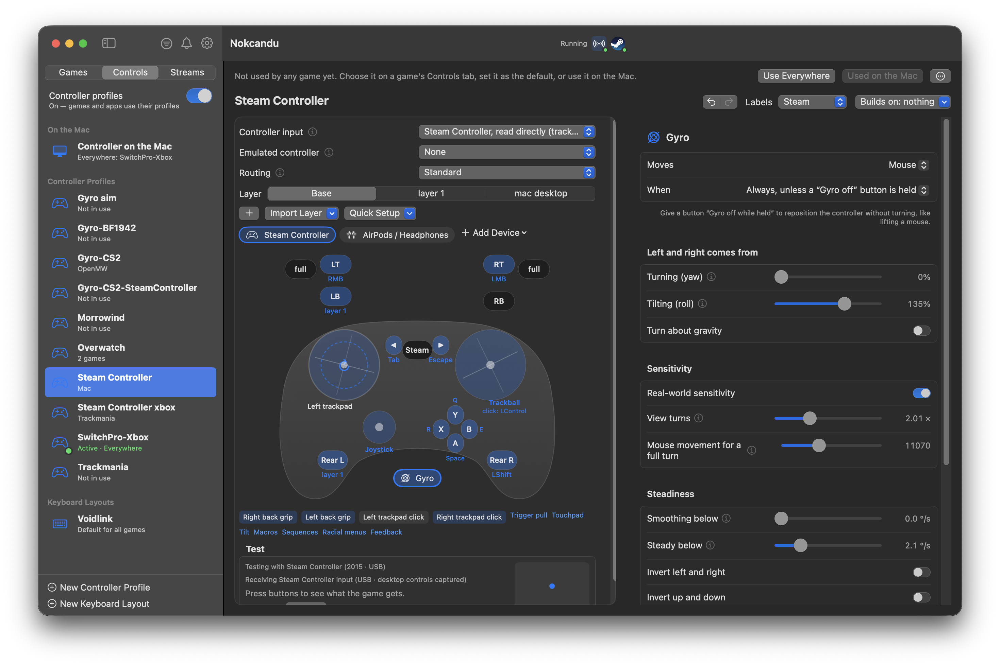
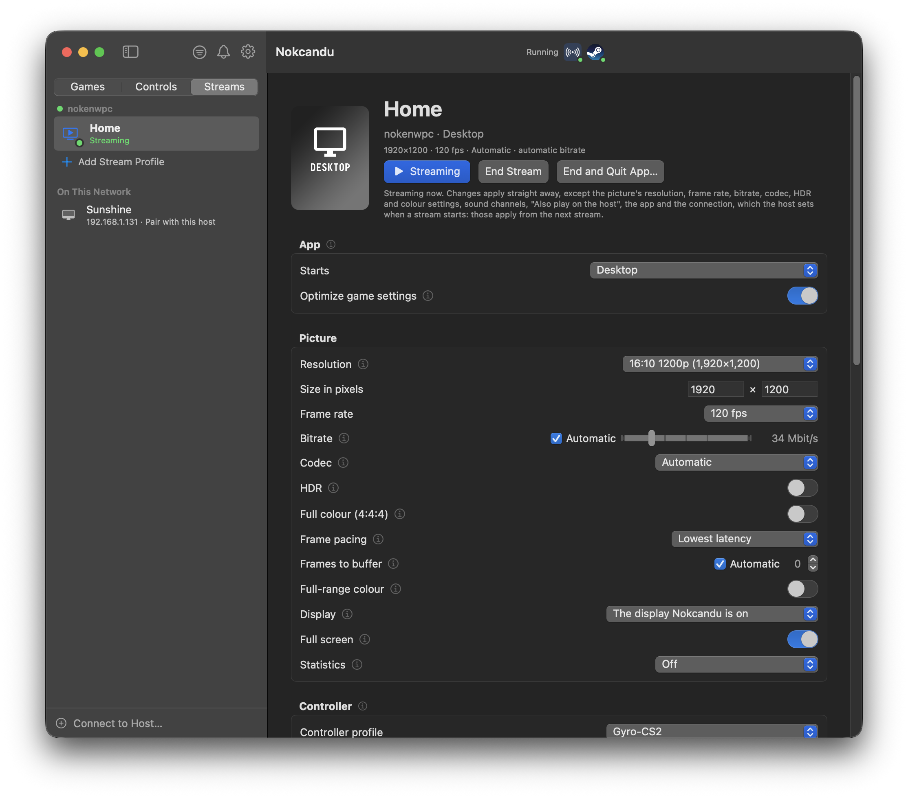
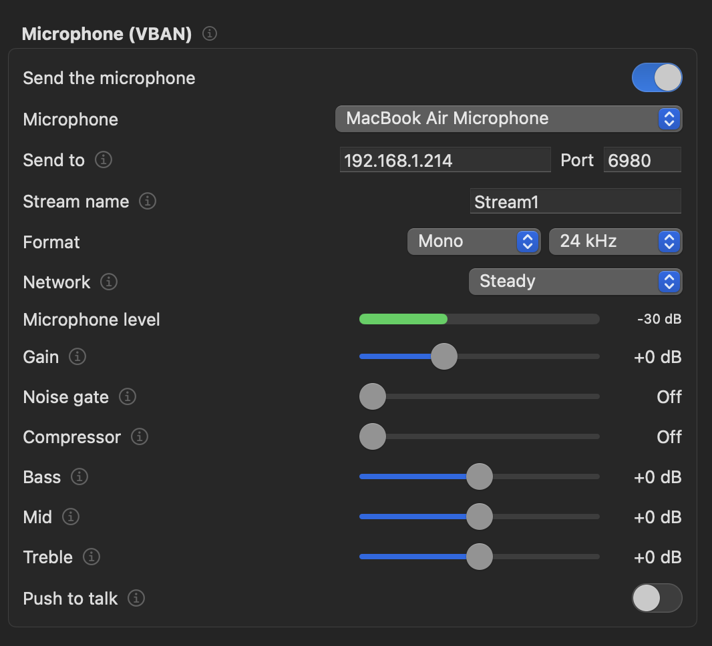
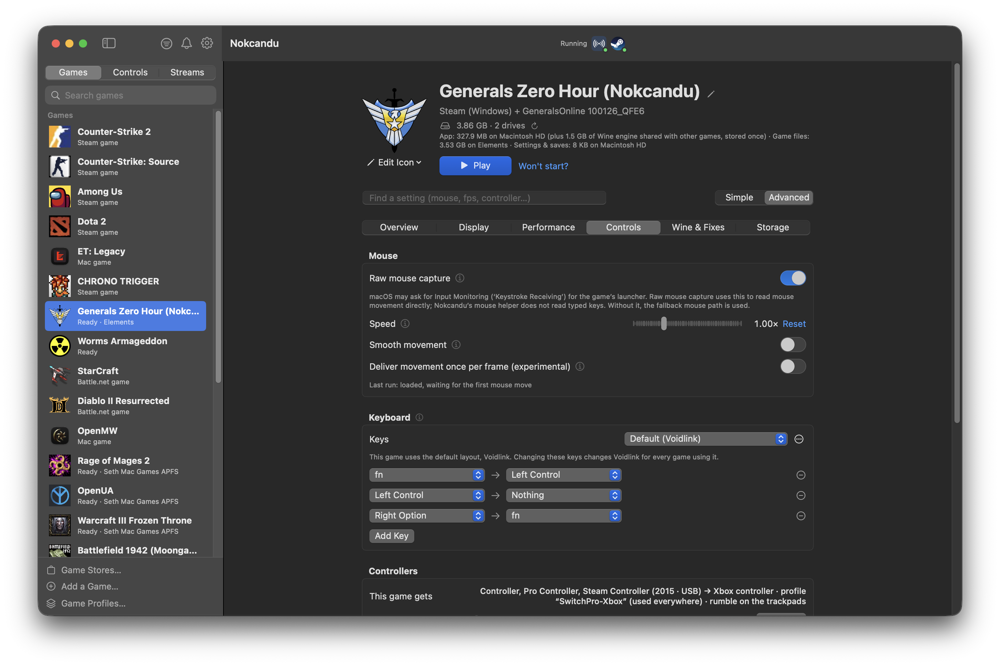

# Nokcandu

**A controller and gyro remapper, a game-streaming client and a Windows game launcher for Apple silicon Macs, in one app.**
One controller profile follows you everywhere: Mac apps, Windows games, and games streamed from your PC.



[**Download the latest release →**](https://github.com/seastwood/Nokcandu/releases/latest) · [Discord](https://discord.gg/FDZMVgPD2S) · Apple silicon, macOS 14 or newer · free and open source (GPL v3)

## Why it's different

- **One profile, three places.** The same remapping, gyro and layers work on the Mac desktop, in Windows games run by Nokcandu, and inside a stream from your gaming PC. You never have to install a game to use the remapper.
- **The original Steam Controller (2015), properly.** Nokcandu reads it directly, on its cable or through its wireless dongle: both trackpads (trackball with momentum, mouse, analog stick, scroll wheel, zones, taps), the rear grips, the gyro and the haptics. No Steam needed.
- **Gyro aiming that holds still.** Turning about gravity, real-world sensitivity, a One Euro filter, and drift that corrects itself quietly whenever the controller rests for a few seconds.
- **AirPods head tracking as an input.** Add head-tracking headphones to a profile and turn your head to steer a stick or pick from a radial menu, with its own activation button and layers. Experimental.
- **Remappable emulated controllers.** Whatever you hold, a profile can present it to Windows games and streams as an Xbox controller, a DualShock 4 or a Switch Pro Controller, with your mappings applied first.
- **Stream your PC's games with your Mac's controller setup.** A built-in Sunshine / Apollo / GameStream client, with your profile's mapped controller, keys and mouse sent to the host.
- **Your Mac's microphone on the host.** A VBAN sender with gain, noise gate, compressor, EQ and push-to-talk, for voice chat in streamed games.

## Controller profiles

Works system-wide. Using a profile outside Nokcandu's own games needs Accessibility access (macOS asks once).

- **Remap everything:** each button, stick direction, trigger, paddle, trackpad and touchpad can be a controller button, a key, a mouse button, the scroll wheel, a macro or a layer switch. Tap, hold, double tap, turbo, combinations and sequences on one button.
- **Layers** that inherit from the base layer, held or toggled, each with its own stick, trackpad and gyro settings. A note on screen, a rumble or a light colour tells you which one you're in.
- **Gyro:** as mouse, stick or scroll; on, off or held with any button or while a trackpad is touched; yaw, roll or turning about gravity; calibration that needs no attention.
- **Steam Controller trackpads:** each pad independently a trackball, mouse, stick, four directions or scroll wheel, with adjustable haptics, sensor-noise filtering that adds no lag to a swipe, a thumb-sweep angle, and up to five zones with their own tap and click.
- **Combine devices in one profile:** joysticks, throttles, pedals, wheels, a second controller, or AirPods, up to four next to the main controller.
- **Radial menus, macros, typed text and an on-screen keyboard**, picked with a stick, the gyro, the mouse or your head.
- **Game rumble everywhere:** a game's vibration plays on the Steam Controller's trackpads, which have no rumble motors.
- **Where a profile applies:** per game, per Mac app, per stream, per connected controller, or **Use Everywhere** from the menu bar. One switch turns it all off.
- **Keyboard layouts** remap keys (including fn/Globe) for games and streams the same way.
- Live test, Quick Setup, undo and redo, profiles that build on each other, and sharing a profile as a file or text.

## Streams



A client for [Sunshine](https://github.com/LizardByte/Sunshine), Apollo and NVIDIA GameStream hosts, built on [moonlight-common-c](https://github.com/moonlight-stream/moonlight-common-c) by way of VoidLink.

- **Hosts and stream profiles:** find hosts on your network or add one by address, pair with a PIN, and keep several profiles per host (app, resolution, frame rate, bitrate, codec, HDR, 4:4:4, display, sound).
- **H.264, HEVC and AV1** decoded in hardware, up to 120 fps, with frame pacing you choose and settings you can change mid-stream.
- **Controllers:** pass your controller through as it is, or use a Nokcandu profile, so the host sees the emulated controller you chose plus your mapped keys and mouse. Gyro aiming on a Steam Controller works in a game running on a Windows PC in another room.
- **Keyboard and mouse** captured for games, with your keyboard layout applied and ⌘ as the Windows key.
- **Clipboard sync** with Apollo hosts (optional, new).



- **Microphone over VBAN:** send any Mac microphone to the host (for example to VoiceMeeter or VBAN Receptor) with a level meter, gain, noise gate, compressor, three-band EQ, mute and push-to-talk.

## Windows games on your Mac



Each Windows game you own becomes its own Mac app, built on [Wine](https://www.winehq.org) through the open-source [Sikarugir](https://github.com/Sikarugir-App) engines.

- **Install from anywhere:** an installer, a disc image, an existing folder, or Steam, GOG, Epic Games, Amazon and Battle.net in one window. External drives are supported, and games can be moved later.
- **Raw mouse capture** (optional): the mouse read directly, without macOS acceleration, for aiming in games that capture it.
- **Play in a resizable window:** the game runs on a virtual screen in a normal Mac window, without changing your Mac's display.
- **Graphics modes** for DirectX 8 through 12 (DXVK, DXMT, Apple's D3DMetal, MoltenVK), an FPS counter, vsync and a frame limit.
- **Game Profiles:** apply settings someone else got working, or share yours in one click. Settings only, no files or scripts, ranked by votes ([Nokcandu-Profiles](https://github.com/seastwood/Nokcandu-Profiles)).
- **Fixes and safety:** one-click fixes (DirectX 8 and 9 extras, borderless windows, cinematics, winetricks), diagnostics and crash recognition. Every file Nokcandu changes is backed up; saves and game files are never touched by repairs or updates.

More detail: [launcher notes](docs/launcher-notes.md).

## Install

1. Download `Nokcandu-<version>.dmg` from [Releases](https://github.com/seastwood/Nokcandu/releases/latest), open it and drag **Nokcandu** into **Applications**.
2. Open Nokcandu. It isn't signed with a paid Apple Developer certificate yet, so the first time macOS says it can't verify the app: click **Done**, open **System Settings → Privacy & Security**, scroll down and click **Open Anyway**. You only do this once.
3. For controller profiles or streams, that's all. For Windows games, the setup checklist installs **Rosetta 2** and downloads the tested Wine engine (about 260 MB).

**Requirements:** Mac with Apple silicon (M1 or later) · macOS 14 Sonoma or newer.

## Good to know

- Only use games you own. Nokcandu doesn't include or download games.
- Games with kernel-level anti-cheat (Valorant, many competitive shooters) generally can't run under Wine. Online play in games with anti-cheat is at your own risk. Streaming them from a PC is not affected.
- Emulated controllers reach Windows games and streams. Mac apps need an Apple entitlement Nokcandu doesn't have yet.
- Apple has announced that full Rosetta ends with macOS 28. All Wine engines are Intel code today; Nokcandu watches for an Apple-silicon engine. Controller profiles and streams don't use Rosetta.
- Problems? [Open an issue](https://github.com/seastwood/Nokcandu/issues); for a game, save its **Diagnostics** report first.

## Credits & licenses

Nokcandu is licensed under the GNU General Public License, version 3 (see [LICENSE](LICENSE)). Releases up to and including 0.12.18 were published under the MIT license, and those copies keep it. The Streams tab's streaming client is derived from [VoidLink](https://github.com/The-Fried-Fish/VoidLink-previously-moonlight-zwm) and [moonlight-common-c](https://github.com/moonlight-stream/moonlight-common-c) (GPL-3.0). At runtime it downloads, from their official releases:
Wine and the Sikarugir engine/wrapper (LGPL-2.1+, [Sikarugir-App](https://github.com/Sikarugir-App)), which bundle DXVK (zlib),
Mesa KosmicKrisp (MIT), MoltenVK (Apache-2.0) and Apple's D3DMetal (Apple's license), and LAV Filters (GPL-2.0, on request).
When you use them: the store clients [gogdl](https://github.com/Heroic-Games-Launcher/heroic-gogdl), [legendary](https://github.com/derrod/legendary)
and [nile](https://github.com/imLinguin/nile) (GPL-3.0, run as separate programs), [winetricks](https://github.com/Winetricks/winetricks) (LGPL-2.1+),
fix data from [umu-protonfixes](https://github.com/Open-Wine-Components/umu-protonfixes) (BSD-2-Clause) and anti-cheat data from
[AreWeAntiCheatYet](https://github.com/AreWeAntiCheatYet/AreWeAntiCheatYet) (MIT).
Nokcandu's Wine Mac driver (for the resizable window) is built from Wine 10.0's source with the patches in
[Engine/winemac](Engine/winemac) (LGPL-2.1+). **Settings → Credits** in the app lists every open-source project
Nokcandu uses, with links to support them.
Nokcandu isn't affiliated with Apple, Microsoft, Valve, Blizzard, GOG, Epic Games, Amazon, EA, Ubisoft or the Wine project.

## Documentation

See the [documentation index](docs/index.md) for engineering learnings, compatibility fixes, troubleshooting records and development notes.

## Build from source

```
./build-app.sh --test --install   # test, build, install to ~/Applications/Nokcandu.app
./make-dmg.sh                     # release DMG in build/
```

Needs Xcode or the Command Line Tools (Swift 5.9+). To release: bump `VERSION`, add `release-notes/v<version>.md`,
then push a tag `v<version>` — GitHub Actions builds, tests and publishes the DMG. More in [docs/DEVELOPMENT.md](docs/DEVELOPMENT.md).
