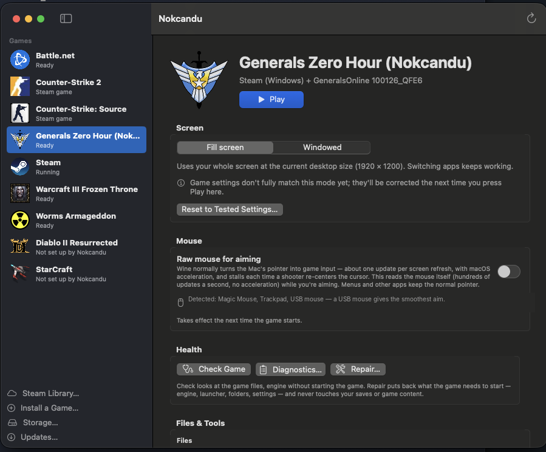

# Nokcandu



**Play the Windows games you own on an Apple silicon Mac — free.** Nokcandu turns each game into its own
Mac app, built on [Wine](https://www.winehq.org) via the open-source [Sikarugir](https://github.com/Sikarugir-App) engines,
with tested settings, one-click fixes and safe updates. Think of it as a free alternative to CrossOver.

[**Download the latest release →**](https://github.com/seastwood/Nokcandu/releases/latest)

## Install

1. Download `Nokcandu-<version>.dmg` from [Releases](https://github.com/seastwood/Nokcandu/releases/latest), open it and drag **Nokcandu** into **Applications**.
2. Open Nokcandu. It isn't signed with a paid Apple Developer certificate yet, so the first time macOS says it can't verify the app:
   click **Done**, open **System Settings → Privacy & Security**, scroll down and click **Open Anyway**. You only do this once.
3. The setup checklist installs **Rosetta 2** (Apple's Intel translator, which Wine needs) and downloads the tested Wine engine (about 260 MB).
4. Click **Install a Game…** or **Set Up Steam**.

**Requirements:** Mac with Apple silicon (M1 or later) · macOS 14 Sonoma or newer · space for your games (external SSDs work).

## What it does

- **Any Windows game you own** — run its installer, install from a disc image (.iso, mounted automatically), add an existing game folder, or download with Steam. Nokcandu picks the game's program, suggests a graphics mode from what the game uses, and extracts its icon.
- **Game stores** — Steam, GOG, Epic Games and Amazon in one window (sign in, install, Mac versions when available), plus Battle.net and optional EA app / Ubisoft Connect. Every game gets its own Mac app with its icon.
- **Real Mac apps** — games show under their own names in the Dock and macOS turns on **Game Mode** in full screen.
- **Your games, your drives** — choose where each game installs (external drives included), move games later, and see which ones need a drive plugged in. Mac games you already have can be added too.
- **Graphics modes** — Classic 3D (DirectX 8/9 → Vulkan), Modern 3D (DirectX 10/11), Apple Metal (DirectX 11/12, 64-bit), DXMT (DirectX 10/11 → Metal), Classic 2D, Compatibility.
- **Raw mouse capture** — optional and off by default; reads your mouse directly whenever a game captures it (aiming, camera control) (hundreds of updates a second, no macOS acceleration), which can improve aiming in compatible games. Toggle it while playing; compatibility varies by game.
- **Performance** — FPS counter, vsync, frame limit. **Drives** — map D:, E:… to external SSDs. **Storage** — see and free space.
- **Fixes & health** — Optional DirectX 8 compatibility (d3d8to9 + bundled DXVK 2.3), DirectX 9 shader extras, borderless windows, cinematic playback (LAV Filters), known community fixes (winetricks), anti-cheat notes, Repair, Diagnostics, crash recognition with suggested fixes, notes per game.
- **Stays current** — checks this repo for new Nokcandu releases and the Sikarugir/LAV projects for new components. New engines are self-tested before they're offered, each game tries them separately, and you can roll back.
- **Safe by design** — every file Nokcandu changes is backed up and journaled; your saves and game files are never touched by repairs or updates.

## Game Profiles

Stuck on a game? Open **Game Profiles** in Nokcandu (or the [website](https://seastwood.github.io/Nokcandu-Profiles/)), search for it,
and apply the settings someone else got working — or try a profile from a similar game, with one-click Undo.
Got a game running? **Share This Setup…** on its page submits your settings in one click. Profiles are settings only
(no files or scripts), are checked automatically, and are ranked by 👍/👎 votes. They live in their own repo,
[Nokcandu-Profiles](https://github.com/seastwood/Nokcandu-Profiles) — this repo's Issues are for the app itself.

## Good to know

- Only use games you own. Nokcandu doesn't include or download games.
- Games with kernel-level anti-cheat (Valorant, many competitive shooters) generally can't run under Wine. Online play in games with anti-cheat is at your own risk.
- Apple has announced that full Rosetta ends with macOS 28. All Wine engines are Intel code today; Nokcandu watches for an Apple-silicon engine. Check this page before upgrading to macOS 28.
- Problems? Open the game's **Diagnostics**, save the report, and [open an issue](https://github.com/seastwood/Nokcandu/issues).

## Credits & licenses

Nokcandu's own code is MIT licensed (see [LICENSE](LICENSE)). At runtime it downloads, from their official releases:
Wine and the Sikarugir engine/wrapper (LGPL-2.1+, [Sikarugir-App](https://github.com/Sikarugir-App)), which bundle DXVK (zlib),
Mesa KosmicKrisp (MIT), MoltenVK (Apache-2.0) and Apple's D3DMetal (Apple's license), and LAV Filters (GPL-2.0, on request).
When you use them: the store clients [gogdl](https://github.com/Heroic-Games-Launcher/heroic-gogdl), [legendary](https://github.com/derrod/legendary)
and [nile](https://github.com/imLinguin/nile) (GPL-3.0, run as separate programs), [winetricks](https://github.com/Winetricks/winetricks) (LGPL-2.1+),
fix data from [umu-protonfixes](https://github.com/Open-Wine-Components/umu-protonfixes) (BSD-2-Clause) and anti-cheat data from
[AreWeAntiCheatYet](https://github.com/AreWeAntiCheatYet/AreWeAntiCheatYet) (MIT).
Nokcandu isn't affiliated with Apple, Microsoft, Valve, Blizzard, GOG, Epic Games, Amazon, EA, Ubisoft, CodeWeavers or the Wine project.

## Build from source

```
./build-app.sh --test --install   # test, build, install to ~/Applications/Nokcandu.app
./make-dmg.sh                     # release DMG in build/
```

Needs Xcode or the Command Line Tools (Swift 5.9+). To release: bump `VERSION`, add `release-notes/v<version>.md`,
then push a tag `v<version>` — GitHub Actions builds, tests and publishes the DMG. More in [docs/DEVELOPMENT.md](docs/DEVELOPMENT.md).


### Optional compatibility fixes

A standalone game's **Fixes** panel offers three opt-in components alongside LAV Filters:

- **DirectX 9 extras** downloads Microsoft's June 2010 redistributable and extracts only `d3dx9_43.dll` and `d3dcompiler_43.dll` beside the selected executable, matching its architecture. Nokcandu does not redistribute Microsoft's DLLs.
- **DirectX 8 compatibility** downloads crosire's d3d8to9 1.16.0 (BSD-2-Clause) and selects the Sikarugir runtime's older DXVK renderer. It requires a 32-bit game, **Older 3D games**, and the bundled `renderer/dxvk/wine` build. The default renderer remains unchanged for other games.
- **Fullscreen (Borderless)** uses Nokcandu's source-built Windows helper, available for 32- and 64-bit games. Choose Windowed in the game. The helper sizes visible, unowned game windows to their monitor without changing the Mac's display mode or keeping the game above other apps. It preserves launch arguments and follows restarts of the same executable; unrelated child launchers aren't followed.

These components currently require a game's own managed Windows environment and a program on its private C: drive. Shared Steam/Battle.net/other launcher environments are excluded until per-program routing is available. The generic components don't edit game executables. BF1942 also has a built-in Display recipe: **Apply Recommended BF1942 Display Settings** creates a fingerprint-checked menu copy, sets 1280 × 800 windowed gameplay, keeps the Mac at its desktop resolution, and enables borderless display. Its original executable is preserved. Other BF1942 executable variants need verification before menu-copy support can be enabled.

Each fix records its files and settings. **Undo** restores replaced files and its own DLL rules while preserving other fixes, and refuses to overwrite later manual edits. Quit the game before installing or undoing a fix. Undo installed components before changing the selected executable; undo DirectX 8 compatibility before changing its graphics mode. Profile settings Undo leaves installed components in place: use each component's Undo in Fixes to remove it.

Profiles reference only built-in IDs: `cinematic`, `d3d8to9`, `directx9-extras`, `borderless`. Applying a profile previews downloads and unavailable fixes. Profiles cannot supply binaries, download URLs, scripts, config commands, or patch bytes. Schema 2 can reference Nokcandu’s built-in BF1942 display recipe and a supported gameplay resolution.

Builds compile the Windows helpers with pinned Zig 0.15.2 from [ziglang.org](https://ziglang.org/download/), and the standalone archive tool with [cabextract 1.11](https://www.cabextract.org.uk/) (GPL-3.0-or-later). The app includes cabextract's license, corresponding source archive, and build recipe. Build scripts verify SHA-256 before extraction; `ZIG` may point to an existing official 0.15.2 toolchain.


### Display controls

**Mac screen resolution** changes the Mac's display temporarily. **Window style** selects Game default or the same optional Fullscreen (Borderless) component available in Fixes. **Game resolution**, currently available for standalone BF1942, edits the game's own video profiles and offers 800 × 600 through 1920 × 1200 independently of the Mac's supported screen modes.

BF1942's recommended display button handles the menu-resolution correction separately from gameplay resolution. It accepts only two verified full-file fingerprints, writes a separate `BF1942-Nokcandu.exe`, sets windowed mode, and retains an Undo receipt. Launches verify both the source and corrected copy so a game update cannot silently use a stale copy. Undo restores original video files and removes a borderless component only when the recipe installed it. Components installed separately are retained. Later manual edits are preserved and reported. Graphics translation and shader extras remain separate optional fixes.

The recipe is built into Nokcandu. Schema 2 profiles store its name, supported gameplay resolution, and whether the menu correction is required; Nokcandu still verifies the target executable and applies only its own built-in operations. Profiles never contain executable patches, config commands, or arbitrary paths.


### Complete profiles and storage (0.9.9)

New saved/shared profiles use schema 2 and include experimental once-per-frame mouse delivery and supported BF1942 display settings. Schema 1 profiles still load and preserve the current once-per-frame setting when that field is absent. Older app builds skip schema 2 rather than silently ignoring its new settings. Profile previews identify unsupported game recipes; applying a BF1942 profile to another game never runs its display recipe. Profile Undo restores display files and their prior Undo ledger, while preserving later user edits. Installed component fixes still have their own Undo in Fixes.

The game header shows estimated storage and its drive, with a breakdown for separately stored game files and known settings/saves. A refresh button recalculates it. Native apps added manually are labelled “App” because arbitrary external game data cannot be inferred. Shared Steam/Battle.net runtime space belongs to the shared launcher. APFS allocations are estimates because cloned files may share blocks.

Move tests cover whole apps, renderer-path rebasing, portable per-fix Undo, file-only moves, and return to internal storage. A disposable BF1942 setup was also moved to a connected ExFAT drive and back with byte verification and working Undo. ExFAT is explicitly kept on the files-only path even when macOS reports symlink support; free-space checks fall back to filesystem capacity when the important-usage estimate incorrectly returns zero. Existing games are not relocated automatically.
