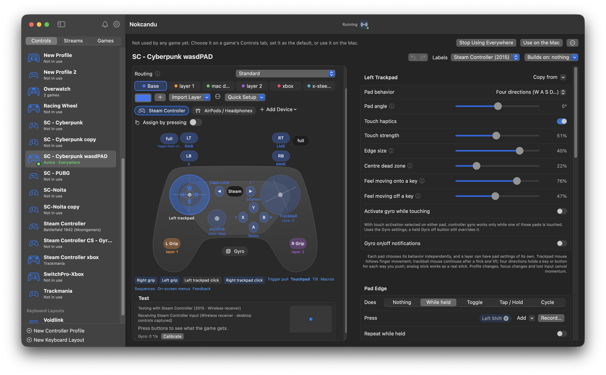
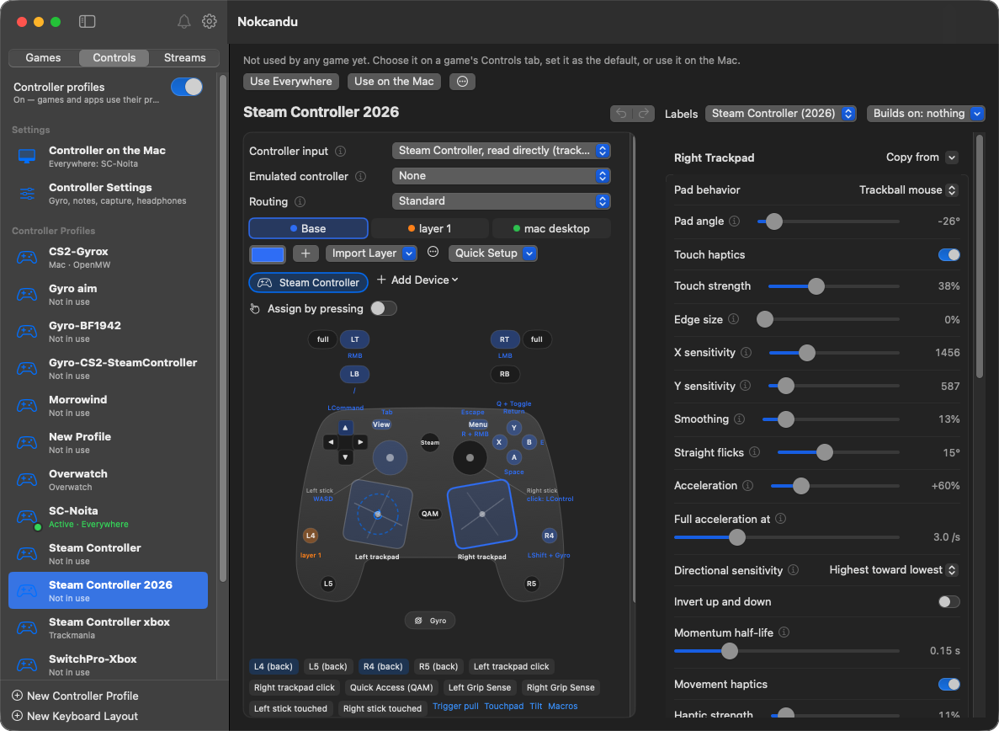
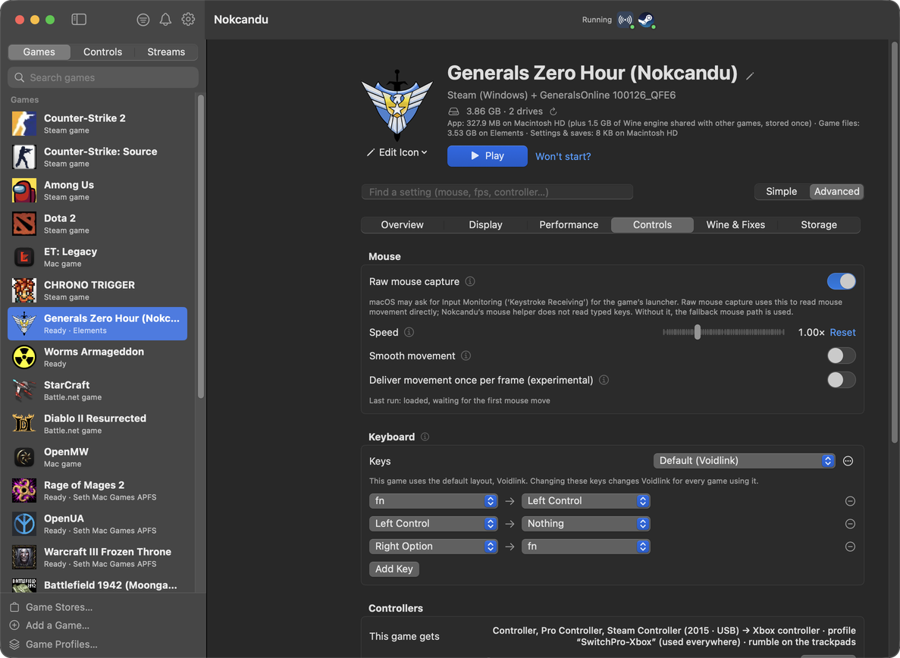
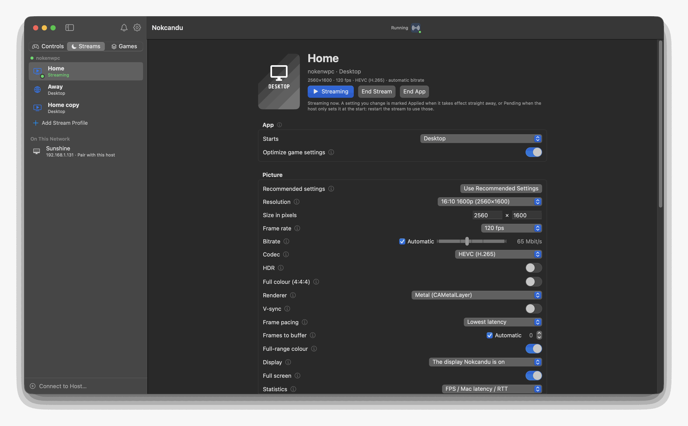

# Nokcandu

**A controller remapper, game-streaming client and Windows game launcher for Apple silicon Macs, in one app.**

[**Download the latest release**](https://github.com/seastwood/Nokcandu/releases/latest) · [Discord](https://discord.gg/FDZMVgPD2S) · Apple silicon, macOS 14 or newer · open source (GPL v3)

<table>
  <tr>
    <td width="50%"><a href="docs/gallery/steam-controller-profile.png"></a></td>
    <td width="50%"><a href="docs/gallery/steam-controller-2026-profile.png"></a></td>
  </tr>
  <tr>
    <td align="center"><em>Steam Controller profile</em></td>
    <td align="center"><em>Steam Controller 2026 profile</em></td>
  </tr>
  <tr>
    <td width="50%"><a href="docs/gallery/windows-game.png"></a></td>
    <td width="50%"><a href="docs/gallery/streams.png"></a></td>
  </tr>
  <tr>
    <td align="center"><em>A Windows game's controls</em></td>
    <td align="center"><em>Streaming from your PC</em></td>
  </tr>
</table>

## Features

- **Remap any controller:** every button, stick, trigger, paddle and trackpad can be a button, key, mouse, scroll, macro or layer switch. Tap, hold, double tap, turbo and combos.
- **Layers** you hold or toggle, each with its own sticks, trackpads and gyro.
- **Gyro aiming** as mouse or stick, with automatic calibration and drift correction.
- **Steam Controller (2015 and 2026), read directly:** both trackpads (mouse, trackball, stick, mouse-like stick, scroll wheel, zones), back grips, gyro and haptics. No Steam needed.
- **Emulated controllers:** present any controller as an Xbox, DualShock 4 or Switch Pro Controller, with your mappings applied.
- **Streaming client** for Sunshine, Apollo and GameStream hosts: H.264, HEVC and AV1 up to 120 fps, your controller profile, keyboard, mouse and Mac microphone sent to the PC.
- **Windows games as Mac apps,** built on Wine: install from a disc, installer, folder, Steam, GOG, Epic, Amazon or Battle.net, keep them on an external drive, and fix them with one click.

## How the remapper works

Nokcandu reads your controller, applies your profile, and hands the result to whatever you're playing. Where it goes decides what the game sees:

| Where you play | What the game gets |
| --- | --- |
| **A Windows game in Nokcandu** | Your mapped controller, as the controller type you chose, through Nokcandu's own Wine controller driver. Keys and mouse go straight to the game. |
| **A stream from your PC** | Your mapped controller, sent to the PC as the controller type you chose, plus keys and mouse. |
| **A Mac app or game** | Buttons mapped to keys and mouse work everywhere (macOS asks once for Accessibility access). Buttons left as controller buttons reach the game as your real controller: macOS lets only apps Apple has approved create a virtual controller. |

**Why build the remapper into the games and streams?** Because Nokcandu runs both ends: it reads the controller *and* delivers to the game. There's no virtual device to install, no driver, and no second app fighting over the controller, so the game sees one controller, never two. Profiles switch by themselves as you change games or start a stream, and turning a profile off gives you the controller back as it is.

## Install

1. Download `Nokcandu-<version>.dmg` from [Releases](https://github.com/seastwood/Nokcandu/releases/latest) and drag **Nokcandu** into **Applications**.
2. The first time, macOS says it can't verify the app: click **Done**, then **System Settings → Privacy & Security → Open Anyway**. Only once; Nokcandu updates itself after that.
3. Controller profiles and streams work right away. For Windows games, the setup checklist installs Rosetta 2 and a tested Wine engine.

## Good to know

- Use only games you own. Nokcandu doesn't include or download games.
- Games with kernel-level anti-cheat generally can't run under Wine. Streaming them from a PC is fine.
- Apple has announced full Rosetta ends with macOS 28. Wine engines are Intel code today; controller profiles and streams don't need Rosetta.
- Problems? [Open an issue](https://github.com/seastwood/Nokcandu/issues). For a game, save its **Diagnostics** report first.

## Build from source

```
./build-app.sh --test --install   # test, build, install to ~/Applications/Nokcandu.app
./make-dmg.sh                     # release DMG in build/
```

Needs Xcode or the Command Line Tools (Swift 5.9+). To release, bump `VERSION`, add `release-notes/v<version>.md` and push a `v<version>` tag. More in [docs/DEVELOPMENT.md](docs/DEVELOPMENT.md) and the [documentation index](docs/index.md).

## Credits & licenses

Nokcandu is licensed under the GNU General Public License, version 3 (see [LICENSE](LICENSE)). Releases up to and including 0.12.18 were published under the MIT license, and those copies keep it.

- The streaming client is derived from [VoidLink](https://github.com/The-Fried-Fish/VoidLink-previously-moonlight-zwm) and [moonlight-common-c](https://github.com/moonlight-stream/moonlight-common-c) (GPL-3.0).
- Downloaded at runtime from their official releases: Wine and the Sikarugir engine/wrapper (LGPL-2.1+, [Sikarugir-App](https://github.com/Sikarugir-App)), which bundle DXVK (zlib), Mesa KosmicKrisp (MIT), MoltenVK (Apache-2.0) and Apple's D3DMetal (Apple's license), and LAV Filters (GPL-2.0, on request).
- When you use them: the store clients [gogdl](https://github.com/Heroic-Games-Launcher/heroic-gogdl), [legendary](https://github.com/derrod/legendary) and [nile](https://github.com/imLinguin/nile) (GPL-3.0, run as separate programs), [winetricks](https://github.com/Winetricks/winetricks) (LGPL-2.1+), fix data from [umu-protonfixes](https://github.com/Open-Wine-Components/umu-protonfixes) (BSD-2-Clause) and anti-cheat data from [AreWeAntiCheatYet](https://github.com/AreWeAntiCheatYet/AreWeAntiCheatYet) (MIT).
- Nokcandu's Wine Mac driver (for the resizable window) is built from Wine's source with the patches in [Engine/winemac](Engine/winemac) (LGPL-2.1+).

**Settings → Credits** in the app lists every open-source project Nokcandu uses, with links to support them. Nokcandu isn't affiliated with Apple, Microsoft, Valve, Blizzard, GOG, Epic Games, Amazon, EA, Ubisoft or the Wine project.
